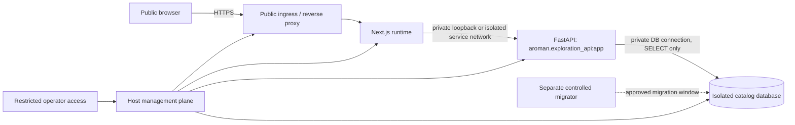
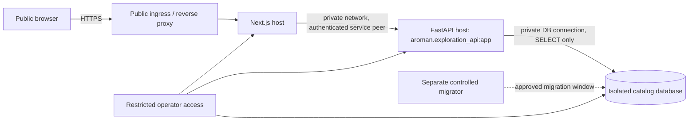
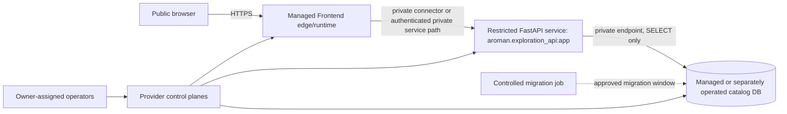

# M6-A26 — Public Launch Architecture and Owner Decision Readiness

**Status: owner decision package only. Recommendation is not approval. D1–D12 remain OPEN; all 13 M6-A23 target controls remain UNVERIFIED; production release is NO-GO. No provider, region, hostname, budget, operator, data publication, infrastructure change, or exposure is selected or authorized.**

## 1. Baselines and evidence boundary

- Frontend requested M6-A26 baseline: `db06f78b9c948044fd6a7ee6824f69d2c81861ba`.
- Backend requested and current pin: `0be24c4597bd693e70348243c26e550a20a8ad0e`.
- Current Frontend documentation/package revision for this batch: branch `docs/m6-a26-launch-architecture-decisions`, starting revision `db06f78b9c948044fd6a7ee6824f69d2c81861ba`. This is a documentation working baseline, not a release candidate.
- Backend checkout was clean at the requested pin. Backend is not modified.
- M6-A24 (`76ce5fb22904b55792dacdc18842ad38cf8d21ef`) and M6-A25 (`65568465a67b3697903f7337d4d8e831d6b9acf3`) references in their own documents are historical milestone baselines, not the current M6-A26 starting revision or candidate identity.
- Candidate source-tree and compiled-artifact identity must be generated and reviewed later using the M6-A25 candidate mechanism. A Git pin, local test, synthetic fixture, or this recommendation is not production evidence.

## 2. Workstream A — Recommended initial release scope

### Recommendation

Proceed toward a **public, read-only product showcase** as the first release only after D1/D2 explicitly approve public exposure and audience, and after content rights, synthetic/real classification, privacy and target controls are resolved. It is the smallest useful public experience supported by the current integration boundary. This is a technical recommendation, not a scope selection or release approval.

The showcase can present a Persian-first, responsive catalog and three client-side exploration experiences. Catalog requests pass through the Frontend same-origin handler, which currently allowlists only five GET templates and strips caller headers, rejects redirects, limits response size/time, and returns generic upstream errors. Actual public availability, security posture, catalog completeness, accessibility and content publication rights are not established by the code alone.

### Included, excluded, and limitations

| Area | Proposed first-release treatment |
| --- | --- |
| Public fragrance catalog | Read-only brand, product, variant, fragrance-family and fragrance-note data through the five exact GET templates in section 4. Empty/error/loading states should remain understandable. |
| Guided Studio | Client-side guided choices and recommendation from available catalog/rule data. No account or server-side saved state. |
| Creative Studio | Client-side composition/concept exploration and local navigation/transfer only. A draft is transient and must not be represented as saved. |
| Conceptual Smart Perfumer | Clearly labeled conceptual/rule-based recommendation experience; no claim of AI inference, professional formulation, safety validation, or personalized advice. |
| Persian-first responsive interface | Persian/RTL as primary presentation, responsive layout. Verify actual strings, font licensing, RTL behavior, keyboard/touch use and supported widths before release. |
| Accounts, login, OTP, real SMS | Excluded. Any login/cart/checkout remnants must not advertise or expose an operational capability; public route review is required. |
| User persistence, saved concepts, profiles | Excluded; no account-linked or server-persisted user concepts. Local/browser behavior must be reviewed for data handling and claims. |
| Orders, cart, checkout, payments | Excluded. Product browsing must not imply purchasability, stock, authoritative price, fulfillment or transaction acceptance. |
| Admin, full Backend, docs/OpenAPI, database, management | Private and unreachable to public clients. Never expose `aroman.main:app`; the intended catalog target is only `aroman.exploration_api:app`. |

### Actual Backend dependency

Backend is a runtime catalog dependency, not merely a build-time integration. The Frontend’s configured server-side `AROMAN_CATALOG_UPSTREAM_URL` points at the restricted API base. The target process must use the pinned Backend revision and `aroman.exploration_api:app`. The Frontend same-origin proxy templates are:

1. `GET /api/v1/brands`
2. `GET /api/v1/products`
3. `GET /api/v1/products/{product_id}/variants`
4. `GET /api/v1/fragrance-families`
5. `GET /api/v1/fragrance-notes`

The proxy is a catch-all filesystem route but its implemented handler is an exact method/path/query allowlist, not an arbitrary proxy. A future deployed configuration must preserve that boundary and reach only the restricted app. Backend service health/readiness and database behavior need a provider-neutral contract and target evidence; no production identity is proven here.

### Publication requirements, risks, mitigations

- **Rights and accuracy:** maintain a per-item register with source, rights owner/basis, license/permission, real/synthetic classification, review status, freshness and approval reference. A qualified rights/content reviewer must approve images, brand names, product descriptions, ingredient claims and any fragrance notes before publication.
- **Privacy/data:** classify catalog fields and remove personal or confidential data. Prefer synthetic/demo content unless a content owner approves real public material. Publicly cacheable assets must be intentionally public.
- **Misleading capability:** label the Smart Perfumer as conceptual; state that recommendations do not establish safety/formulation suitability. Mark concepts transient and clarify that no order or purchase is accepted.
- **Availability/upstream coupling:** API/database outage may degrade catalog and recommendation experiences. Use bounded timeouts, generic errors, visible retry/empty states, health monitoring and a release stop/rollback path.
- **Abuse and resource consumption:** public endpoints need bounded query validation, response/time limits, rate/availability monitoring and provider/network protections reviewed for the selected topology. Do not infer a public API’s safe capacity from local tests.
- **Exposure drift:** excluded frontend routes may exist in the broader application. Validate the compiled public scope and every public route; do not assume navigation hiding is access control.
- **Market, regional, provider and legal constraints:** determine intended markets, data location/transfer, hosting/provider availability, sanctions/export/payment-adjacent obligations where applicable, consumer/content/advertising rules, and rights requirements with qualified owners. This package makes no legal or regulatory conclusion.

### Exact scope decisions for approval

The owner must record D1: approve or decline this named read-only public showcase scope, enumerating included screens/routes, data classes, audience and every excluded capability. D2 must set public audience/reachability, permitted catalog data and any geographic or access constraints. Separate content/legal approval must authorize actual assets and claims. D3, D5–D8, D10 and D11 decisions define the deployment/recovery approach; D4 is required before public hostname or TLS setup. No decision is inferred from this recommendation. D9 and D12 remain separate excluded-scope decisions and are not prerequisites to authorized private preproduction preparation.

## 3. Workstream B — Architecture alternatives

All three alternatives serve the same trust contract: public clients can reach the Frontend only; the Frontend reaches a private restricted catalog API; that API reads approved catalog objects only; the database and administrative surfaces are private. Diagrams show logical boundaries, not provider selections or address plans. DNS, TLS termination, actual ports and regions remain D3–D5 choices.

### A. Public Frontend + private API + isolated database on segmented single host

- **Trust/network:** public ingress terminates at a hardened reverse proxy; Frontend/API/database are separate processes and identities on host-local sockets or isolated networks. Database and admin ports have no public listener. Host compromise crosses all service boundaries, so segmentation is meaningful only if separately enforced.
- **Flow:** public DNS resolves to ingress. TLS is terminated at the reverse proxy or re-encrypted to Frontend. Next same-origin requests use a private service address to FastAPI; FastAPI connects privately to DB. Egress is restricted to required package/build, monitoring, time/DNS and backup destinations, with the exact list decided per implementation.
- **Identities/permissions:** distinct OS/service identities for Next, API, database runtime, migrator and operator; no root runtime; API DB identity SELECT-only on approved catalog objects. Migrator is short-lived/separately invoked. Host administrators are highly privileged and auditable.
- **TLS/DNS/secrets:** owner-appointed DNS operator owns records; ingress/certificate operator owns issuance, renewal and expiry alerts. Runtime secrets delivered from a controlled host secret facility or protected files with narrow permissions; never in image, browser bundle, arguments or logs. A single-host secret compromise has broad blast radius.
- **Operations/recovery:** one operator may maintain host OS, reverse proxy, app services, database, patching, logs, monitoring and backups. Host failure is a common-mode outage. Recovery requires host rebuild or restore, artifact rollback and DB recovery rehearsal.
- **Complexity/failure/security:** lowest infrastructure count and potentially simplest private networking. Highest correlated failure and compromise risk; noisy-neighbor/resource exhaustion, host/provider outage, misconfigured firewall or accidental service exposure can affect all layers. Secure only if OS hardening, process isolation, firewalling, backups and independent monitoring are credible.
- **Cost categories:** one host compute/storage, backups, traffic/egress, domain/DNS and certificate services if paid, monitoring/logging, operator time, redundancy/recovery capacity. No quote or budget is assumed.
- **Initial suitability:** plausible for a deliberately small, low-criticality read-only launch if owner accepts single-host outage and a competent operator can demonstrate isolation/recovery. Not preferred if independent failure domains, high availability, or strict separation are required.

### B. Public Frontend + private API on separate hosts + isolated database

- **Trust/network:** public ingress reaches Frontend only. Private network rules admit Frontend-to-API and API-to-DB paths only; management access is separately restricted and logged. API host accepts no public/untrusted peers.
- **Flow/egress:** browser HTTPS to Frontend; server-side proxy call to private API; API SELECT to DB. Explicit egress policy per host. Frontend needs no direct DB route. API need not have general Internet egress.
- **Identities/permissions:** separate host/service identities and credentials per component; private service identity or mTLS/workload identity between Frontend/API where supported; DB runtime SELECT-only, separate migrator and operator roles.
- **TLS/DNS/secrets:** public DNS/TLS on ingress. Private service TLS or equivalent authenticated channel based on owner-approved trust model. Private DNS and certificate issuance/renewal have explicit owners. Secret delivery scoped per host/service; no shared administrator credential.
- **Operations/recovery:** patching, deployment, logs and monitoring span hosts and private network. Independent host failure is better isolated but network/DNS/security-group changes create new failure modes. Backups/restores must cover the separately managed DB and artifact/config revisions.
- **Complexity/failure/security:** stronger separation and smaller blast radius than A; more identities, network policies, certificates, observability and coordinated changes. Risks include permissive private network, direct API exposure, private DNS outage, credential sprawl, asymmetric failures and harder debugging.
- **Cost categories:** multiple compute instances, private networking/traffic, DB/storage, backup and monitoring, ingress, DNS/TLS, security operations and operator time; redundancy increases cost. No quote is assumed.
- **Initial suitability:** strong conventional choice when isolation and independent service boundaries matter and the owner has staff/process to run multi-host infrastructure. Likely excess operational burden for a very small showcase without a responsible operator.

### C. Managed Frontend/hosting + restricted private API + managed or separately operated DB

- **Trust/network:** public managed edge/runtime; private connector or tightly authenticated private path to API; database private endpoint. Confirm whether the managed Frontend runtime can reach the selected API without publishing the API origin. Provider control planes and support access join the trust model.
- **Flow/egress:** browser to managed TLS edge; Frontend server proxy to API; API to DB. Review platform-specific outbound restrictions, build/runtime boundary, preview deployments and artifact promotion. Avoid client-side upstream secrets.
- **Identities/permissions:** provider service/workload identities for Frontend-to-API and API-to-DB; provider control-plane roles assigned narrowly; runtime DB SELECT-only; separate migration job identity. Audit vendor support/admin access and identity federation.
- **TLS/DNS/secrets:** domain/DNS owner maps approved hostname to managed edge. Provider certificate lifecycle and renewal alerts must be reviewed. Use platform secret store/identity injection with role-bound access; verify build logs, previews and artifact handling do not expose secrets.
- **Operations/recovery:** divide responsibility between owner and vendors under explicit support/SLA, incident, audit, backup and data export terms. Monitoring integration, data residency, retention/deletion, restore testing, portability and provider incident escalation need named owners.
- **Complexity/failure/security:** reduces host patching and can provide managed identity, TLS and backup features; vendor control plane, lock-in, opaque runtime/network controls, preview bypasses, policy misconfiguration, service limits, regional availability and provider account compromise become central risks. “Managed” does not imply private or compliant.
- **Cost categories:** usage/build/runtime tiers, managed DB/storage/backup, private connectivity, egress, logs/metrics, support tiers, domain/DNS and engineering/operations time. Variable traffic and platform features may change cost; no quote or budget is assumed.
- **Initial suitability:** attractive if selected providers can demonstrate private API connectivity, exact identity/grant controls, region and data terms, reliable evidence export and acceptable cost/support. Suitability is conditional on owner/provider verification, not assumed convenience.

### Recommendation and decision criteria

Use **B as the technical starting architecture for M6-A27 planning**, with the smallest practical deployment of separate Frontend and restricted API hosts and an isolated database. Its explicit service boundary best matches the already implemented same-origin server proxy and required API/database separation. This recommendation assumes an assigned operator can maintain private networking and multiple components, and that intended market/provider/location constraints allow it. If that assumption fails, compare A’s accepted single-host common-mode risk against C’s verified private connectivity, contract, region, portability, operational ownership and cost. The owner chooses D3; this document selects nothing.

Before D3 approval, compare: intended audience/markets; provider availability and legal/data terms; private connectivity; independent failure boundaries; operator skills/coverage; required uptime and recovery targets; artifact/data export; auditability; projected usage and cost categories; and testability of all 13 controls. No architecture can be called public-ready without target evidence.

## 4. Workstream C — Provider-neutral deployment contract (non-executable)

This is an implementation contract for later authorization, not a deployable configuration.

### Runtime and build contract

- Frontend: Node.js runtime compatible with the pinned lockfile/toolchain, Next.js `^16.4.2`, React/React DOM `^19.3.1`, package-lock frozen install, and the repository’s `npm run build` wrapper. The wrapper validates explicit public-showcase scope/API settings, builds into the dedicated `.next`, and writes candidate/build metadata. Deploy only its immutable output after candidate verification; do not build on a production host unless separately designed and reviewed.
- Browser API base: `/api/v1` for same-origin proxy. `AROMAN_CATALOG_UPSTREAM_URL` is server-only runtime configuration, exact `/api/v1` base, no credentials/query/fragment. It must identify the private restricted API. It is never `NEXT_PUBLIC_*`, compiled into browser data, or recorded as a raw infrastructure value in candidate metadata.
- Backend: pinned source `0be24c4597bd693e70348243c26e550a20a8ad0e`; ASGI target exactly `aroman.exploration_api:app`. Never deploy/route public traffic to `aroman.main:app`. Use reviewed Python dependency lock/install procedure from the pinned Backend repository; no pin or Backend files change in this milestone.
- Run only the restricted catalog app with a non-root, non-interactive dedicated runtime identity, restricted filesystem and egress, bounded worker/resources, and private listener. Provider-specific commands and values are deferred to M6-A27 after approval.

### Exactly five allowed catalog GET API templates

Only these templates may be forwarded and succeed through the public Frontend path:

1. `GET /api/v1/brands`
2. `GET /api/v1/products`
3. `GET /api/v1/products/{product_id}/variants`
4. `GET /api/v1/fragrance-families`
5. `GET /api/v1/fragrance-notes`

Preserve endpoint-specific bounded query validation from the implementation. Reject other methods, paths, ambiguous/encoded/noncanonical forms, unknown/duplicate/bad parameters, and redirects. No caller cookies, authorization, identity, or forwarding headers pass upstream; use generic errors, JSON-only response, existing timeout/size bounds, and no arbitrary destination. Review the Backend route registry and route behavior at the pinned revision before deployment.

### Same-origin proxy, identities, and database

- Browser requests only the Frontend origin. Next.js proxy has a fixed private upstream configured by the operator; request input cannot choose host, scheme, port or path outside the five templates.
- API ingress accepts only the approved Frontend service identity/network peer. A private service identity (or equivalent authenticated channel) is required; network filtering alone is insufficient where peer identity can be spoofed or shared. Exact mechanism is an architecture input.
- API database identity can `SELECT` only explicitly approved catalog tables/views/columns as needed. It cannot write, DDL, read excluded objects, execute unauthorized functions, grant, create roles or escalate. Verify negative privileges.
- Use a distinct, manually/temporarily released migration identity, absent from Frontend/API runtime, public build and ordinary operator environment. Migration approval, schema compatibility and recovery path precede each migration. Operator/admin identity is separate again.

### Non-secret environment contract

| Variable / setting | Purpose | Exposure |
| --- | --- | --- |
| `AROMAN_RELEASE_SCOPE=public-showcase` | Select compiled public scope | Build input; metadata records scope |
| `NEXT_PUBLIC_AROMAN_API_BASE_URL=/api/v1` | Browser uses same-origin API proxy | Public by design; not a secret |
| `AROMAN_CATALOG_UPSTREAM_URL=<private-api-base>/api/v1` | Server-side fixed proxy upstream | Non-secret value but infrastructure-sensitive; server runtime only; redact from logs/evidence |
| Backend DB host/database identifier | Private DB selection | Runtime-only non-secret configuration; avoid publishing details |
| Log level, timeout/resource bounds, health path, environment name | Operational policy | Non-secret; reviewed and versioned |

Do not create a production environment file in this milestone. Credentials, private keys, tokens, passwords and secret-store references with embedded authority are not examples. Values shown here are schema-level placeholders, not executable settings.

### DNS, certificates, proxy, health and access matrix

- DNS owner controls only the approved public hostname and records; verify ownership and authoritative/independent answers. Avoid wildcard, preview and stale aliases. Private service discovery is separately controlled.
- Public reverse proxy admits HTTPS only, redirects or denies HTTP, forwards only approved host/path behavior, sets trusted forwarding headers itself, strips caller-supplied forwarding headers, enforces request/body/time limits and does not expose admin/status endpoints. Upstream TLS or protected local/private transport is selected and reviewed.
- Certificate issuer/renewal owner, expiry monitoring and failure escalation are assigned. TLS baseline, chain and supported clients are explicitly approved and tested. Exact origins/CORS values are topology-specific; same-origin browser operation should not need permissive CORS.
- Health: liveness confirms process responsiveness without disclosing configuration. Readiness checks required API/DB connectivity and schema compatibility with bounded work; public status must not leak internal topology or DB detail. Health endpoints are not an alternate catalog surface. Startup must fail closed if required public scope/upstream configuration is absent or malformed.

| Source | Destination | Allowed purpose | Required disposition |
| --- | --- | --- | --- |
| Public clients | Public ingress → Frontend | HTTPS web experience and same-origin catalog paths | Allow approved hostname only; deny Backend, DB, admin, preview and alternate origin paths |
| Frontend runtime identity | Restricted API service | Five catalog GET templates only, private authenticated peer | Allow only fixed API service/destination; deny public API bypass and general egress unless approved |
| Restricted API identity | Catalog DB | SELECT approved catalog objects | Private DB endpoint only; no management or internet path |
| Migration job identity | Catalog DB | Approved schema migration in controlled window | Separate short-lived authorization; no public route or runtime reuse |
| Operators | Management/control planes | Approved administration, audit, release and recovery | Restricted enrollment, MFA where supported, attributable access; no shared credentials |
| Components | Logging/monitoring/backup endpoints | Approved telemetry and recovery | Explicit destinations, minimal data and least privilege; no secrets/PII in telemetry |

No addresses, ports, CIDRs, firewall rules, hostnames or credentials are assigned here. Network reviewer must translate this matrix to a target-specific allow/deny map and independently verify it.

### Secrets, operations and recovery ownership

- Project owner assigns security/secrets authority, service identity owners, approvers, break-glass authority and incident response path. Operators document access audit, rotation/revocation, compromise response and separation between build/runtime/migration.
- Logs are structured and redacted: request template/method/status, correlation ID, upstream class/latency, process health and deployment revision where approved. Exclude credentials, tokens, authorization/cookie headers, OTP, full phone numbers and unapproved personal/catalog data. Access/retention/deletion are owner-approved.
- Monitoring covers Frontend/API availability and latency, 4xx/5xx, upstream/DB failure, resource saturation, certificate expiry/renewal, candidate/revision mismatch, migration health, backup status and alert delivery. Named responder and escalation/acknowledgement expectation required; test delivery and tabletop.
- Backup decision is D7: approve retained-data backup, retention, encryption/key custody, access, deletion, restore authority, cadence and numeric RPO/RTO; or explicitly approve no backup for justified disposable data. Read-only application access does not remove DB recovery requirements.
- D11 assigns release/stop/rollback/recovery authorities and acceptable downtime/data loss. Prefer restoring previous immutable frontend/API artifacts with compatible schema. Never assume destructive migration downgrade is safe; decide forward-fix versus isolated restore with DB and release owners.

### Candidate integrity, release sequence and stop gates

1. Freeze an approved source revision and verify clean source identity, Backend pin and dependency lock; review scope and content register.
2. Build once in controlled CI/release environment with explicit public-scope and same-origin settings. Capture M6-A25 source tree, build metadata and compiled artifact digest/file count; reject symlinks/mismatch and retain immutable artifact by digest.
3. Independently review source/candidate, dependency/toolchain, config identity, route inventory, exclusions, content rights and secret scans. Do not treat the revision string alone as artifact identity.
4. In an approved private environment, provision only after applicable D1/D2, D3, D5–D8, D10–D11 decisions and separate spend/implementation authority. D4 must be resolved before public hostname/TLS setup or exposure; D9/D12 remain out of the initial private implementation scope. Create isolated services/DB, least-privilege identities, secrets path, monitoring, backups or approved no-backup state, and applicable private transport/network controls. Capture exact non-secret config identity.
5. Apply schema only with approved separate migrator after backup/recovery readiness and compatibility review. Start API then Frontend; verify readiness, exact five GETs, all denied routes/methods, DB grants, secret/log behavior and private-origin isolation.
6. Candidate deploy: promote the exact immutable artifact by digest, never rebuild between test and promotion. Record previous artifact/config/schema identifiers. Use a bounded change window, independent reviewer and stop-capable operator. Public cutover is outside this package and requires separate explicit authorization and all controls PASS.
7. Rollback: on any stop condition, keep/return traffic to the last approved candidate only if schema compatibility is established. Otherwise isolate and follow owner-approved forward-fix or restore process. Re-run health, exact routes, excluded-capability, isolation and integrity checks before any resumption.

Stop for unresolved applicable decisions/authority, candidate mismatch, unexpected listener/route/data/secret, rights uncertainty, runtime grants beyond SELECT, public/private bypass, failed TLS/network/health/migration/alert/recovery gate, unassigned owner, failed evidence capture, or any relevant control remaining UNVERIFIED at public acceptance. An independent reviewer must validate evidence and findings; only the owner can record final GO. All target controls remain UNVERIFIED and release NO-GO until then.

## 5. Workstream D — D1–D12 owner workbook

Decision names, choices and dependencies below follow the actual M6-A15 register. **Every decision remains OPEN.** Recommendations are explicitly technical; the owner supplies business choices, assignments, permissions and approvals. Minimum inputs are only what can be known now; later target evidence remains required.

| ID / status | Choices and recommendation | Dependencies; implications and cost/maintenance | Minimum owner input; work unlocked after approval |
| --- | --- | --- | --- |
| **D1 — OPEN: first scope** | Options: private exploration; later authenticated saved concepts; separately approved public exploration; defer. **Technical recommendation:** approve only the bounded public read-only showcase described in §2 if content and audience are acceptable. Commerce remains separate. | None. Public scope adds public exposure, content rights, availability and support obligations. Narrow scope avoids account/SMS/persistence/transaction work. | Owner chooses audience, screens/routes, data classes and explicit exclusions; specifies exposure intent. Then freeze product/route acceptance and implementation boundary. |
| **D2 — OPEN: privacy/access boundary** | Choose permitted audience, access method and data, or defer exposure. For this proposal, public access means no login, so public data must be approved for unrestricted viewing; narrow audience requires a separately selected control. | D1. Public reachability increases abuse/content risk; private access adds identity, support and revocation operations. Cost depends on controls and data restrictions. | Audience/geography, permitted catalog data, public/private preference, removal/support expectations and data classification. Then threat model and authorized test locations. |
| **D3 — OPEN: hosting/location/network** | Owner/architect chooses A/B/C or defers. **Technical starting recommendation: B**, conditional on an assigned multi-component operator; compare A for accepted common-mode risk and C after provider verification. | D1/D2. Determines trust boundaries, private links, failure domains, region, cost categories, skills and provider/legal review. | Intended markets/data location constraints; operator capability; uptime/recovery expectations; procurement/spend authority; preferred risk tradeoffs. Then target-specific topology, provider diligence and cost estimate. |
| **D4 — OPEN: domain/DNS/TLS** | Owner-selected hostname/domain and DNS/certificate ownership, or defer. No domain proposed. | D3. Public naming/certificate renewal has continuous ownership and outage/security consequences; domain/DNS recurring cost may apply. | Domain ownership/control (or decision to obtain one later), DNS operator role, certificate lifecycle owner and intended public origin. Then record exact origin and renewal plan. |
| **D5 — OPEN: ingress/routing/origins** | Choose topology-specific reverse proxy and same-origin BFF policy, exact origins/CORS, trusted peers and forwarded-header policy. **Technical recommendation:** retain same-origin Frontend proxy; no direct browser API origin. Cookie SameSite only if auth is separately approved. | D3/D4; D1 for auth. Misconfiguration can expose API or allow spoofing/bypass. More gateways/policies add maintenance. | Exposure paths, approved origin(s), ingress owner and acceptable peer-auth mechanism; state auth is out of scope for this release. Then implement peer/path allowlist and bypass tests. |
| **D6 — OPEN: database/migrations** | Choose isolated DB/environment and assign runtime, migrator, operator, migration and recovery ownership, or defer. **Technical recommendation:** runtime SELECT-only on catalog objects; separate migrator. | D1/D3. DB service/HA/patching and migrations drive cost, outage and data-loss risk. | Catalog data persistence/ephemerality, DB owner role, environment separation, approved objects, migration authority. Then grant matrix, migration/recovery design and private readiness. |
| **D7 — OPEN: backup/recovery objectives** | Set retention, numeric RPO/RTO, encryption/key custody, restore authority/cadence, or explicitly approve no backup for justified disposable data. | D1/D6. Backups add storage, security and rehearsal burden; no-backup accepts irreversible loss. | Data value/retention, acceptable loss and downtime, restore role, key/access policy and rehearsal cadence. Then specify and rehearse restore or record approved disposable-data rationale. |
| **D8 — OPEN: secrets/identities** | Choose secret delivery, service identities, access approvals, rotation/revocation and incident handling for selected topology. | D3/D6. Secret-store/platform cost and access administration; weak separation increases compromise blast radius. | Security/secrets authority role, service identity ownership, approved access/revocation process and break-glass custodian. Then implement secret flow/audit and rotation rehearsal. |
| **D9 — OPEN: real SMS/OTP** | Options: not in scope; separately evaluate provider; defer accounts. **Recommendation for this milestone:** keep out of scope. Do not infer the historic provider preference is selection. | D1; D3/D8 if activated. Adds provider expense, delivery/abuse handling, personal data and compliance review. | Explicit future decision only if accounts need OTP; owner, template/budget/commercial authority and technical/compliance review. Then separate evaluation; no activation from M6-A26. |
| **D10 — OPEN: monitoring/logging/incident operations** | Choose service, signals, thresholds, retention, alert delivery, on-call/incident owner, support and response expectation. | D1/D3. Ongoing service and staff cost; absent coverage extends outages and mishandles incidents. | Accountable operations and incident roles/alternates, acceptable response expectations, retention/access constraints and escalation channel. Then build signal inventory, alert tests, tabletop and redaction evidence. |
| **D11 — OPEN: deployment/release/recovery authority** | Assign release owner, maintenance window, rollback authority, acceptable downtime/data loss and runbook, or defer. | D3/D6/D7/D10. Requires availability of accountable people and rehearsal time; unclear authority makes recovery unsafe. | Release/stop/rollback/restore roles and alternates, change window, downtime/loss limits and explicit authority to withdraw traffic. Then implement and rehearse release/rollback gates. |
| **D12 — OPEN: future commerce** | Keep commerce out of scope; identify product lines for later assessment; or defer. **Recommendation:** defer separate from the showcase. | Independent of technical foundation unless D1 expands scope. Commercial/manufacturing/legal/safety/payment/fulfillment obligations and costs. | No input needed to unlock M6-A27 if commerce is explicitly excluded; otherwise identify later product lines and qualified approving functions. Then separate product-line validation and approval milestone. |

### Smallest owner decision set to unlock M6-A27

Prioritize D1 and D2 (scope, public audience/data boundary), D3 (architecture/location/provider direction and implementation/spend authority), D5 (same-origin/private routing contract), D6 (database/environment and owner), D7 (backup disposition/objectives), D8 (identity/secrets owner), D10 (monitoring/incident owners), and D11 (release/recovery authority). D4 is needed before any public hostname/TLS configuration, but provider-neutral private implementation planning can continue before a hostname is selected. D9 and D12 are not prerequisites to private preproduction implementation while OTP and commerce remain excluded. The existing M6-A25 release gate nevertheless treats every OPEN D1–D12 decision as a public-release NO-GO; a later public GO requires explicit owner decisions recording D9/D12 as out of scope, or a separately reviewed gate-policy change. D3 must not be interpreted as permission to spend or provision; explicit implementation authorization and budget authority are prerequisites.

Decision types remain distinct: §3 recommendation is technical; D1/D2/D12 include business/product choices; D6–D11 require operational assignments; content rights and publication require qualified legal/content approval; D3/D4 may require procurement/domain authority; none of these is deployment authorization.

## 6. Workstream E — M6-A27 implementation handoff

### Prerequisites and exact inputs

Before target-specific implementation: owner-recorded D1/D2 scope and audience; approved D3 alternative and location/provider direction with explicit budget/spend/implementation authority; D5 routing and trust model; D6 database and migration owner; D7 backup/no-backup disposition and numeric objectives if retained; D8 security/secrets authority; D10 monitoring/incident assignment; D11 release/stop/recovery roles. D4 exact hostname and certificate owner are required before DNS/TLS target setup or exposure. Content owner/right reviewer must provide publication register and approval. Intended markets and data location/transfer constraints must be supplied for qualified review. D9/D12 remain excluded.

Architecture inputs to freeze: selected topology and trust diagram; service identities; source/destination/port allow/deny matrix; public hostname/origin if applicable; private API discovery and authenticated peer mechanism; database endpoint/access policy; data/object allowlist; secret-store and logging destinations; health/readiness design; backup and recovery objectives; operator/reviewer roles; cost category estimate and spend limit; approved build config identity; target acceptance evidence storage/retention policy.

### Workstreams and dependencies

1. **Product/content gate:** freeze routes and Persian-first copy; audit public route tree and excluded pages; register catalog provenance, claims, image/font rights and synthetic/real content; content/legal approval. Blocks artifact finalization.
2. **Candidate pipeline:** freeze Frontend source and Backend pin; dependency/toolchain review; public-showcase build; source-tree and compiled digest; immutable storage and promotion. Depends on scope and route contract.
3. **Network/identity foundation:** implement approved ingress, private service link, identity/peer authentication, DNS/TLS (once D4 supplied), firewall allow/deny and admin path. Depends on approved D3–D5.
4. **Database and migration:** isolate environment/database, provision exact catalog objects, SELECT-only runtime role, separate migrator/operator identities, migration review and recovery rehearsal. Depends on D6/D7/D8 and approved data classification.
5. **Frontend/API runtime:** deploy exact artifacts/process identities, fixed same-origin upstream, health/readiness, resource/time bounds, route/method tests, no full-app target, no runtime secrets in build. Depends on 2–4.
6. **Operations/recovery:** logs/redaction/access/retention, alerts/thresholds/delivery, incident tabletop, backups/restore, rollback path, role assignment and rehearsal. Depends on D7/D10/D11 and target.
7. **Independent acceptance:** collect target evidence for all 13 controls, validate references and pins, record findings/exceptions and expiry, independent review. Owner decides whether to authorize any later public exposure; no automatic release.

### Security acceptance criteria

- Only the pinned restricted `aroman.exploration_api:app` runs for catalog access; no reachable `aroman.main:app`.
- Public clients reach only HTTPS Frontend; API accepts only approved Frontend peer/identity; database/admin/management/private origins and previews are unreachable from public/unauthorized networks.
- Exactly the five GET templates succeed; other paths, methods, variants and redirects fail closed before protected handlers.
- Runtime DB grants are SELECT-only on approved catalog objects; write, DDL, excluded reads, grants and escalation are denied; migrator is separate and absent from runtime.
- Login, OTP, account, SMS, user persistence, saved concepts, orders, checkout and payment are absent/unreachable.
- Public content has current rights/provenance approval. Build/runtime/migration secrets are separated and absent from public assets, logs and evidence. Logs meet redaction and approved retention rules.
- Health/readiness does not leak secrets/topology; monitoring reaches named response owner; approved backup/recovery or no-backup decision is demonstrated.
- Candidate digest/revision/config identity matches the independently reviewed release record; no rebuild or silent config drift occurs during promotion.
- All 13 controls have target-specific evidence and independent review before any owner GO. Until then each is UNVERIFIED and release NO-GO.

### Private verification, deployment and rollback

Build and verify immutable candidate offline first. In the approved private environment, test from at least public/unauthorized and explicitly allowed peer locations without probing beyond written authorization. Verify DNS/TLS only when D4 and exact target authorization exist. Record denied as well as allowed flows, exact route/method outcomes, process identity, DB negative grants, redacted secret/log scan, alert delivery, migration record, backup/restore and recovery times. Deploy candidate to private environment, compare health and behavior, then have independent reviewer check evidence. Public cutover requires a separate owner authorization after all applicable controls PASS and owner records GO.

Keep previous immutable artifacts/config IDs and schema revision. Stop on any failed or unverified gate, protect/withdraw traffic only under assigned authority, and use code rollback only if schema compatibility is established. Otherwise owners choose approved forward fix or isolated restore. Re-run readiness, route, exclusion and isolation checks before resuming. Never infer safe downgrade.

Expected evidence artifacts: signed/controlled decision record; selected topology and peer/port map; content-rights register reference; source/build/candidate manifests and artifact digest; dependency/build logs with secrets redacted; process/service identity inspection; DNS/TLS and network probe outputs when authorized; exact route/method matrix; DB grants and negative tests; secret access/rotation and artifact scans; redacted log samples/retention review; health/monitor/alert/tabletop results; migration and backup/restore/rollback rehearsal records; 13-control evidence package; independent review and owner disposition.

Blocking issues today: owner decisions and implementation/spend authority; no selected provider/region/hostname/network; no named operators/reviewers; no accepted RPO/RTO or data backup disposition; no approved catalog publication register; no production candidate; no target evidence; market/legal/provider constraints unverified. No production control can currently be PASS.

### Safe preparation before approval vs approval-gated operations

**Can prepare safely now:** document route/scope inventory; draft rights/provenance register schema and request source metadata; refine build/artifact evidence checklist; draft topology diagrams and environment-variable schema; identify required negative tests and evidence fields; review repository docs and code-level tests; draft candidate release/change/rollback records with placeholders.

**Must wait for recorded decisions and explicit authorization:** selecting/buying services or domain; procurement/spend; provisioning or changing infrastructure, DNS, firewall, secrets or certificates; creating production identities/databases; publishing data/assets; live target probes; deployment, migration, backup operation, public exposure or release. M6-A26 performs none of these.

## 7. Workstream F — Documentation consistency and control crosswalk

M6-A25/M6-A23 continue to govern candidate integrity and target evidence. This package adds the decision-ready first-scope recommendation, three public architecture alternatives, provider-neutral contract and next-milestone handoff. It does not replace historical milestone records or their baseline labels. Older docs that label a milestone baseline remain historical; their source history is not rewritten to imply M6-A26 identity.

The following is the exact M6-A23 acceptance-control crosswalk. Every current disposition remains **UNVERIFIED**:

| M6-A23 control | M6-A26 decision/contract coverage | Status |
| --- | --- | --- |
| `domain_dns` | D4; DNS ownership and records in §4 | UNVERIFIED |
| `https_tls` | D4/D5; certificate and reverse-proxy contract in §4 | UNVERIFIED |
| `network_isolation` | D3/D5; trust diagrams and access matrix | UNVERIFIED |
| `catalog_target_routing` | Pinned `aroman.exploration_api:app`; candidate and runtime contract | UNVERIFIED |
| `catalog_routes` | Exactly five GET templates in §2/§4 | UNVERIFIED |
| `excluded_capabilities` | Scope exclusions in §2 and M6-A27 criteria | UNVERIFIED |
| `database_migrations` | D6, runtime SELECT-only and separate migrator | UNVERIFIED |
| `content_provenance` | Publication register and qualified rights approval in §2/§6 | UNVERIFIED |
| `environment_secrets` | D8; build/runtime/migration boundaries in §4 | UNVERIFIED |
| `logging` | D10; redaction, access and retention contract | UNVERIFIED |
| `monitoring_incident` | D10; signal, alert and response requirements | UNVERIFIED |
| `backup_rollback_recovery` | D7/D11; recovery criteria and handoff | UNVERIFIED |
| `release_signoff` | D11; immutable candidate, independent review and owner GO gate | UNVERIFIED |

The actual D1–D12 wording, allowed alternatives, dependencies and evidence expectations were checked against `M6_A15_OWNER_DECISION_REGISTER.md`; all identifiers are represented in §5 and all remain OPEN. `M6_A25_TARGET_ACCEPTANCE_CHECKLIST.md` remains the detailed control procedure. The five CI jobs and existing application security boundaries remain unchanged. No application feature or Backend code change is part of M6-A26.

## 8. Review disposition

**READY FOR OWNER REVIEW** means this architecture/decision package is concrete enough to review; it does not mean the system is ready for deployment. Current state remains: D1–D12 OPEN; 13/13 target controls UNVERIFIED; candidate not designated; production release NO-GO. M6-A27 implementation begins only after its prerequisites and separate implementation authorization are recorded.

### Related project records

- [M6-A15 owner decision register](M6_A15_OWNER_DECISION_REGISTER.md)
- [M6-A23 target readiness and 13-control matrix](M6_A23_PUBLIC_TARGET_READINESS.md)
- [M6-A23 procedural deployment runbook](M6_A23_PUBLIC_DEPLOYMENT_RUNBOOK.md)
- [M6-A24 integrated verification](M6_A24_INTEGRATED_VERIFICATION.md)
- [M6-A25 owner decision packet](M6_A25_OWNER_DECISION_PACKET.md)
- [M6-A25 target acceptance checklist](M6_A25_TARGET_ACCEPTANCE_CHECKLIST.md)
- [M6-A25 candidate integrity and integrated release gate](M6_A25_INTEGRATED_RELEASE_GATE.md)
- [M6-A21 public catalog integration](M6_A21_PUBLIC_CATALOG_INTEGRATION.md)
- [M6-A22 public release hardening](M6_A22_PUBLIC_RELEASE_HARDENING.md)
- [M6-A19 owner decision matrix](M6_A19_OWNER_DECISION_MATRIX.md)
- [M6-A18 reference architecture](M6_A18_REFERENCE_ARCHITECTURE.md)
