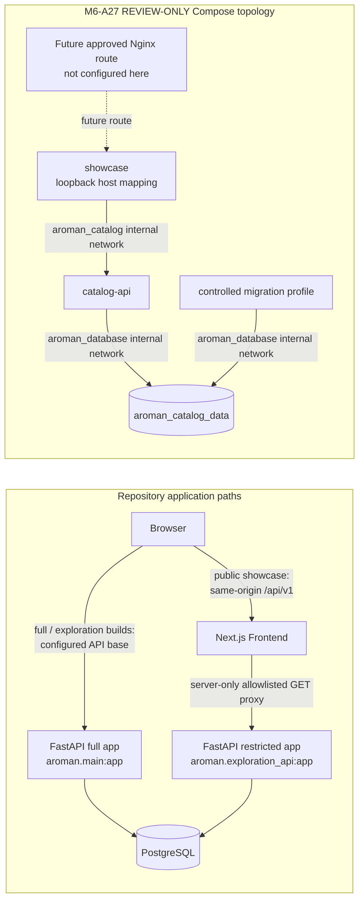

# M6-A28A — Architecture and Deployment Inventory

**Inventory date:** 2026-11-01
**Frontend inspected:** `develop`, `9859529b7d01c6359dc09ec988d35c5979508e96`
**Backend inspected read-only:** `develop`, `0be24c4597bd693e70348243c26e550a20a8ad0e`
**Scope:** repository implementation and configuration only. No target server, deployment, database, Docker resource, or external service was accessed.

## Evidence rules

This inventory treats checked-in source, lockfiles, Compose/Docker files, and tests at the revisions above as primary evidence. [PROJECT_MASTER_PLAN.md](PROJECT_MASTER_PLAN.md) uses earlier repository baselines. [DEVELOPMENT_STATUS.md](DEVELOPMENT_STATUS.md) records Frontend `ffc9023…`; [LAUNCH_READINESS.md](LAUNCH_READINESS.md) records older Frontend and Backend SHAs and labels its M6-A26 scope historical. Their statements are not treated as current without corroboration in the checked source. The M6-A27 operator handoff is the current repository planning reference, but its future target commands are explicitly approval-gated and not executed.

## Components and deployment states

| Component | Verified repository implementation | Deployment status |
| --- | --- | --- |
| Frontend | Next.js App Router, React, TypeScript, Persian-first RTL; catalog, Guided Studio, Creative Studio, conceptual Smart Perfumer, login/account, and placeholder cart/checkout pages. `src/app/`, `src/components/`, `package.json`. | Source and test code exist. A built candidate or running service is not established by this inventory. |
| Full Backend | FastAPI modular monolith `aroman.main:app`; catalog, authentication/session, user, and saved-concept routers. `../../Backend/aroman/main.py`, `../../Backend/aroman/*/api.py`. | Backend source exists at the pinned SHA. It is not running or deployed as part of this inventory. |
| Restricted catalog API | Separate FastAPI app `aroman.exploration_api:app`; startup validates the registered routes and middleware permits only the five catalog GET route templates. `../../Backend/aroman/exploration_api.py`. | Used as the proposed M6-A27 public-showcase API image entry point. Image build and deployment are not established. |
| PostgreSQL | SQLAlchemy models and Alembic migrations; local Backend Compose uses PostgreSQL 17 Alpine. `../../Backend/aroman/models.py`, `../../Backend/alembic/`, `../../Backend/docker-compose.yml`. | Disposable CI/rehearsal evidence exists in tests and docs; no target database was inspected. |
| M6-A27 private Compose template | Frontend, restricted API, PostgreSQL, and controlled migration profile; private networks, one loopback Frontend mapping, file-backed secrets, and project volume. `../deploy/private-preproduction/compose.yaml`. | Explicitly REVIEW ONLY. It does not establish a live preproduction environment or approved artifact identities. |

## Architecture diagram

The existing browser API client uses `NEXT_PUBLIC_AROMAN_API_BASE_URL` in browser code and prefers server-only `AROMAN_API_BASE_URL` for server requests (`src/lib/api/client.ts`). Public same-origin builds set the browser base to `/api/v1`; the Next route then uses server-only `AROMAN_CATALOG_UPSTREAM_URL` and reconstructs a permitted path/query (`src/app/api/v1/[...path]/route.ts`, `src/lib/public-showcase-config.mjs`). The public browser bundle must not contain the private upstream URL or credentials.

## Request and data flows

1. **Full application path:** the browser calls the configured API base with credentialed requests. `src/lib/api/client.ts` defines catalog, auth, user, and concept operations. The full Backend mounts these routers beneath `/api/v1` (`../../Backend/aroman/main.py`). Actual network reachability depends on deployment configuration and has not been verified.
2. **Public catalog path:** the browser calls only same-origin `/api/v1` in public-showcase mode. `src/app/api/v1/[...path]/route.ts` allows `GET /brands`, `/products`, `/fragrance-families`, `/fragrance-notes`, and `/products/{UUID}/variants`; it bounds query length/values and response size, rejects redirects/non-JSON, and returns 404 for unknown paths and 405 for unsupported methods. The server forwards GET only to the validated exact `/api/v1` upstream base. The restricted Backend app separately rejects unregistered routes and non-GET methods (`../../Backend/aroman/exploration_api.py`).
3. **Database path:** full FastAPI accesses PostgreSQL through SQLAlchemy (`../../Backend/aroman/core/db.py`). The restricted app uses the same application database layer, but its proposed M6-A27 runtime identity is granted SELECT only on five named catalog tables by the M6-A27 migration grant script (`../deploy/private-preproduction/apply-catalog-read-only-grants.py`). This grant has not been applied to any target database.
4. **Studio behavior:** Guided/Creative flows and Smart Perfumer are Frontend features driven by catalog data/configuration; Smart Perfumer is conceptual, not a formulation or manufacturing service (`src/app/studio/`, `src/lib/studio/`, `docs/M1E2_SMART_PERFUMER_SPEC.md`). Existing full app also supports saved-concept APIs; M6-A27 public scope excludes persistence.

## API contract and Backend pin

The Frontend pin is `0be24c4597bd693e70348243c26e550a20a8ad0e` in [scripts/backend-pin.mjs](../scripts/backend-pin.mjs). The CI workflows check out this revision; `scripts/check-api-contract.mjs` exports the pinned Backend OpenAPI and compares it with `docs/openapi.m1a.json` and generated TypeScript. This proves contract drift checks are configured, not that a current hosted CI run or deployed API is healthy.

The public API contract is deliberately smaller than the full Backend:

| Public template | Backend route | Method |
| --- | --- | --- |
| `/api/v1/brands` | `/api/v1/brands` | GET |
| `/api/v1/products` | `/api/v1/products` | GET |
| `/api/v1/products/{UUID}/variants` | `/api/v1/products/{product_id}/variants` | GET |
| `/api/v1/fragrance-families` | `/api/v1/fragrance-families` | GET |
| `/api/v1/fragrance-notes` | `/api/v1/fragrance-notes` | GET |

These route registrations are in `src/app/api/v1/[...path]/route.ts` and `../../Backend/aroman/exploration_api.py`. The full API additionally includes authentication, `/users/me`, and saved concept routes (`../../Backend/aroman/main.py`, `../../Backend/aroman/authentication/api.py`, `../../Backend/aroman/users/api.py`, `../../Backend/aroman/fragrance_concepts/api.py`).

## Authentication and sessions

The full Backend implements mobile OTP challenge/verification, session cookies, CSRF protection, and authenticated saved concepts. OTP and session digests use separate peppers (`../../Backend/aroman/authentication/api.py`, `../../Backend/aroman/core/config.py`). Cookies are HttpOnly and configured Secure/SameSite; authenticated writes require CSRF (`../../Backend/docs/PREPRODUCTION_TRANSPORT_SECURITY.md`). The default SMS provider is `unconfigured`; `FakeSMS` is in-memory test tooling and there is no active real SMS provider (`../../Backend/aroman/authentication/sms.py`). The Kavenegar adapter is documented and tested offline; it is not an active integration (`../../Backend/aroman/authentication/kavenegar.py`, `../../Backend/tests/test_kavenegar_offline.py`).

M6-A27's selected public-showcase scope excludes login, OTP/real SMS, accounts, user persistence, saved concepts, orders, checkout, and payments. The review-only template launches only `aroman.exploration_api:app`, not the full app (`../deploy/private-preproduction/Dockerfile.catalog-api`, `../deploy/private-preproduction/compose.yaml`). A real target route boundary has not been verified.

## Database, schema, migration, and permissions

Backend declares 11 SQLAlchemy tables in `../../Backend/aroman/models.py`: `users`, `auth_challenges`, `auth_verify_attempts`, `auth_sessions`, `brands`, `fragrance_families`, `fragrance_notes`, `products`, `product_variants`, `fragrance_concepts`, and `concept_notes`. Alembic history has two checked revisions: `d9670763b00d` (initial foundation) then `a4b01` (durable OTP delivery status), in `../../Backend/alembic/versions/`.

The Backend local Compose and `docs/PREPRODUCTION_DATABASE.md` define a PostgreSQL bootstrap/operator, `aroman_migrator` owner, and `aroman_app` identity. The full app role receives catalog reads plus limited auth/concept DML; migrations are run separately as migrator (`../../Backend/infrastructure/postgres/01-app-role.sh`, `../../Backend/aroman/administration/grant_app_role.py`, `../../Backend/docker-compose.yml`). The SQL role and migration gates use disposable PostgreSQL in tests; they do not prove target grants.

M6-A27 narrows the public catalog API's runtime role to read access on `brands`, `fragrance_families`, `fragrance_notes`, `products`, and `product_variants`; the controlled migration profile applies Alembic before granting this allowlist (`../deploy/private-preproduction/database-role-init.sh`, `../deploy/private-preproduction/apply-catalog-read-only-grants.py`, `../deploy/private-preproduction/compose.yaml`). The PostgreSQL image/template, grant process, credentials, schema identity, and resulting target privileges are not yet deployed or verified. The template's bootstrap database identity is not a complete human operator-accounting or access-management solution.

## Docker topology and trust boundaries

| Control | Repository evidence | Actual state |
| --- | --- | --- |
| Dedicated AROMAN networks | M6-A27 Compose declares `aroman_catalog` and `aroman_database`, both `internal: true`. | Implemented in REVIEW-ONLY template; no live network. |
| No external/unrelated network attachment | Compose lists only those two networks and services attach by name. | Template property; effective target config and host routing are unverified. |
| No host networking, privileged mode, or Docker socket | These are absent from the template; `scripts/validate-private-compose.mjs` checks effective synthetic configuration and negative fixtures. | Verified by repository tests against rendered synthetic Compose only. |
| API/DB host ports | Only `showcase` publishes a port; catalog API and PostgreSQL have no `ports` stanza. | Template property; no host firewall validation. |
| Frontend host boundary | Frontend publishes to `127.0.0.1`; future Nginx is not configured here. | Template property only. IPv4/IPv6 Docker/UFW and real proxy behavior remain unverified. |
| Runtime identities/filesystems | Frontend/API/migration specify UID/GID 10001; services use read-only root filesystems, dropped capabilities, no-new-privileges and bounded tmpfs. PostgreSQL has a custom image and a limited capability set. | Template and local disposable PostgreSQL checks, not target-container evidence. |
| Volumes/mounts | One named AROMAN database volume; fixed read-only role/grant config files and file-backed secret sources. No socket or arbitrary bind mount is allowed by the validator. | Template property; no volume has been created by this inventory. |

Frontend and API have resource, PID, health, and restart settings in the template; database has `pg_isready`, and migration is a no-restart controlled profile (`../deploy/private-preproduction/compose.yaml`). Full Backend local Compose has a DB healthcheck but no API healthcheck or explicit resource/restart/security restrictions (`../../Backend/docker-compose.yml`). The default Docker log driver/rotation is not configured in these Compose files. Backend disables Uvicorn access logging and logs database failures by exception type (`../../Backend/Dockerfile`, `../../Backend/aroman/main.py`); no current target logging/monitoring/alerting delivery was verified.

## Secrets and configuration boundary

Backend Settings requires `DATABASE_URL`, distinct `OTP_PEPPER` and `SESSION_PEPPER` of at least 32 characters; production/staging also require PostgreSQL, Secure cookies, HTTPS origins, and non-fake SMS (`../../Backend/aroman/core/config.py`). Backend docs require runtime secret injection and rotation (`../../Backend/docs/PREPRODUCTION_TRANSPORT_SECURITY.md`). Backend's tracked Compose interpolates password values into container environment at startup, which is a local development pattern, not evidence of production secret management (`../../Backend/docker-compose.yml`).

M6-A27 uses external file references for seven private secret files and requires immutable image references, exact approved CORS origin, database name and loopback host port (`../deploy/private-preproduction/compose.yaml`, `../scripts/validate-private-compose.mjs`). Its runbook specifies root-only directory and group-readable file ownership. API/migration processes read only their assigned files and export resolved values for their own process; the Frontend receives no backend/database secrets. No actual secret directory or secret value was inspected in this milestone. No image was built, so absence from a future image still requires artifact review.

## Health, logs, backup, restore, and rollback

Full Backend exposes `/health/live` and `/health/ready`; readiness checks PostgreSQL connectivity and that `alembic_version` matches the current migration head (`../../Backend/aroman/main.py`). Local Backend Compose checks PostgreSQL with `pg_isready`. M6-A27 Compose checks Frontend `/`, restricted catalog GET, and PostgreSQL readiness. These checks establish process/service readiness only in configured environments; no target service is running here.

Backend's `docs/POSTGRES_BACKUP_RESTORE.md` describes an automated disposable PostgreSQL dump/restore test using independent temporary clusters, synthetic data, and grant/readiness checks. This is not a production backup schedule, encrypted off-site archive, retention policy, RPO/RTO, or target restore. M6-A27's runbook requires separately approved backup/restore evidence and a rollback decision path before future deployment; neither has occurred. There is no current production rollback or disaster-recovery capability verified by repository inspection.

## Current implementation versus proposed future architecture

- **Implemented in repositories:** full Next.js/React and FastAPI applications; catalog, authentication, sessions, saved concepts, schema/migrations, dev Compose; public-showcase mode, same-origin allowlisted catalog proxy, restricted FastAPI app, M6-A25 candidate/release gates, and M6-A27 REVIEW-ONLY Compose/tooling.
- **Proposed, not running:** isolated private AROMAN Compose project with Frontend loopback mapping for later approved Nginx routing, private restricted API, isolated PostgreSQL, separate migration profile, approved external secrets and digest-pinned artifacts.
- **Not established:** any live AROMAN preproduction environment; DNS/TLS, Nginx route, host network/firewall isolation, public reachability denial, actual permissions/secrets, monitoring, backup/restore, content-rights approval, or release signoff.

The M6-A27 operator sequence remains approval-gated in [M6-A27 Private Preproduction Runbook](M6_A27_PRIVATE_PREPRODUCTION_RUNBOOK.md). The formal `docs/launch-decisions.example.json` records D1–D12 OPEN; `docs/public-target-evidence.example.json` records 13 controls UNVERIFIED; the private release example remains NO-GO. Owner-selected planning directions do not resolve those formal gates. The historical Afra 80 GB disk target remains PLANNED ONLY in `docs/afra-capacity-input.example.json`.

## Unresolved findings

1. Production target evidence is **MISSING**: no target evidence package or verified target artifact/configuration identities have been collected (`docs/public-target-evidence.example.json`, `docs/private-preproduction-release-record.example.json`). All 13 controls remain UNVERIFIED and no control is claimed PASS.
2. Actual target infrastructure behavior is **UNKNOWN**: ingress boundaries require separately authorized verification, including loopback-only Nginx upstream, API/DB nonreachability, Docker/UFW interactions, and IPv4/IPv6 behavior (`../deploy/private-preproduction/compose.yaml`). Missing evidence is not evidence that the infrastructure is isolated or exposed.
3. Runtime database grants and bootstrap/operator identity need target provisioning and independent audit; local tests are disposable (`../../Backend/docs/PREPRODUCTION_DATABASE.md`, M6-A27 Compose and grant scripts).
4. Backup, restore, monitoring, logging retention/rotation, incident ownership, content rights, and rollback evidence are not established for a real service (`../../Backend/docs/POSTGRES_BACKUP_RESTORE.md`, M6-A27 runbook).
5. D1–D12, including explicit eventual disposition of excluded scope decisions, remain OPEN. Public release remains NO-GO and all 13 target controls remain UNVERIFIED.
6. The development-tooling minimatch dependency risk is temporarily accepted with remediation open; accountability, reassessment triggers, and closure criteria are recorded in the [environment and readiness matrix](M6_A28A_ENVIRONMENT_AND_READINESS_MATRIX.md).

## Primary evidence index

- Frontend: [API integration](API_INTEGRATION.md), [development](DEVELOPMENT.md), [architecture](ARCHITECTURE.md), [M6-A27 runbook](M6_A27_PRIVATE_PREPRODUCTION_RUNBOOK.md), `src/lib/api/client.ts`, `src/app/api/v1/[...path]/route.ts`, `src/lib/public-showcase-config.mjs`, `scripts/backend-pin.mjs`, `scripts/candidate-integrity.mjs`, `scripts/assess-public-release-gate.mjs`, `.github/workflows/ci.yml`.
- Backend at `../../Backend`: `README.md`, `docs/PREPRODUCTION_DATABASE.md`, `docs/POSTGRES_BACKUP_RESTORE.md`, `docs/PREPRODUCTION_TRANSPORT_SECURITY.md`, `aroman/core/config.py`, `aroman/main.py`, `aroman/exploration_api.py`, `aroman/models.py`, `alembic/versions/`, `docker-compose.yml`, `Dockerfile`, `infrastructure/postgres/01-app-role.sh`, `aroman/administration/grant_app_role.py`, `tests/` and `.github/workflows/ci.yml`.
